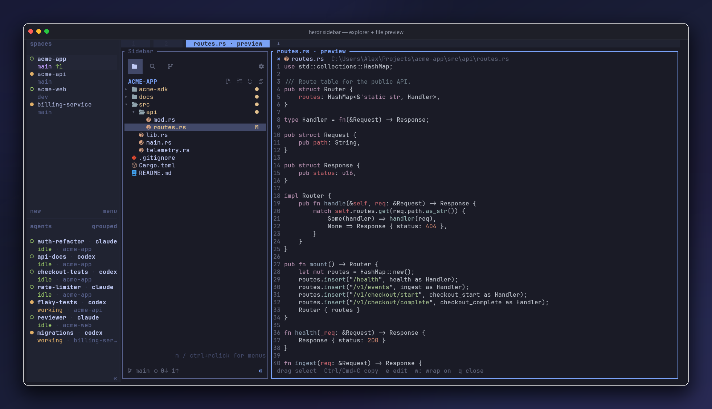
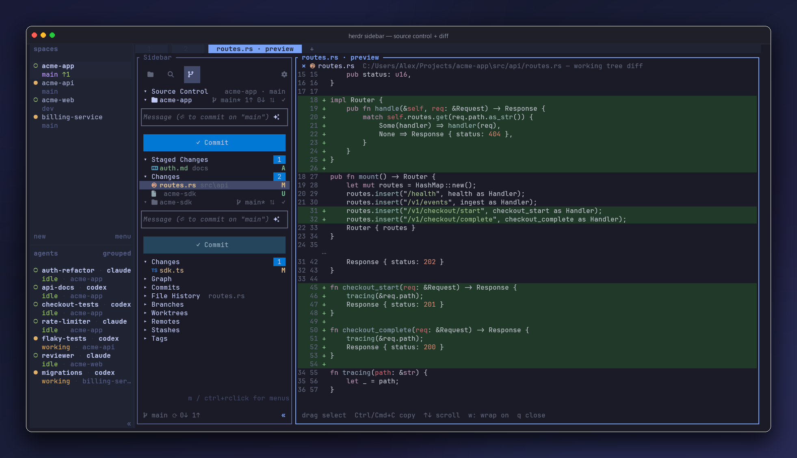
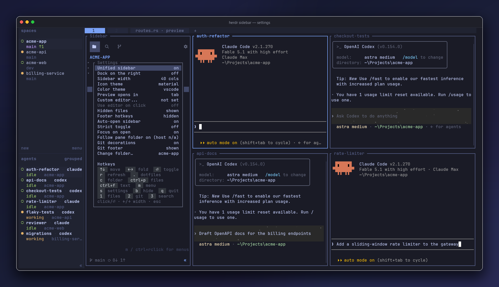

<div align="center">

# Herdr Sidebar

### The sidebar your terminal was missing — inspired by VS Code.

A file explorer that shows one tree per pane on your tab, and a source-control panel per
repository, in one dockable [herdr](https://github.com/ogulcancelik/herdr) pane —
activity-bar switching, mouse-driven controls, AI-drafted commit messages, and file
previews that open as editor tabs — ephemeral until you double-click to pin one.


<br><br>


</div>

If you've ever alt-tabbed out of your terminal just to *look* at the tree, the diff, or
what's staged, this closes that loop.

```sh
herdr plugin install alexarthurs/herdr-sidebar/plugins/herdr-sidebar
```

Tagged releases use SHA-256-verified binaries on supported platforms and fall back to a
source build when needed.

## Three Views

The activity bar switches Explorer and Search instantly in one process; each repository's
⎇ button opens its Source Control. Use the mouse or press `1`, `2`, and `3`.

### Explorer & Preview

<div align="center">

</div>

- One tree per working directory on your tab: every shell and agent pane contributes its
  live directory, trees appear when panes open and go away when they close, and a pane
  inside another pane's directory folds into that tree. Preview tabs mirror the tab they
  were opened from.
- Trees are grouped by repository under a header with the repo name and branch. Click the
  header to fold a group, drag the divider between groups to resize, and press `Tab` /
  `Shift+Tab` to move between them. When the pane runs out of rows, the lowest groups fold
  to their headers on their own.
- Navigate a real expandable tree with file icons, hover actions, Git decorations, and
  `m` / Ctrl+right-click context menus. Listings update live as files are created, renamed,
  or removed on disk.
- Click a file to reuse an ephemeral preview tab; double-click to pin it. Preview in the
  same tab with **Preview opens in: pane**, or opt into experimental `replace` mode:
  working panes move to a temporary tab while you preview; Esc / `q` brings them back.
- Preview text, Markdown (via `glow`), and images (via `viu`).
  Read-only previews support mouse selection and clipboard copy, including OSC 52 over SSH.
- Find files with `Ctrl+P`; search project contents with `Ctrl+F` or `Ctrl+Shift+F`.
  Both span every tree on the tab (results carry a group prefix when there are several) and
  search supports case, whole-word, regex, and include/exclude filters.
- Stage files or folders from the tree without crossing nested-repository boundaries.
- Opt into a terminal editor for mouse clicks, while Enter keeps the built-in preview.
- Per-filetype previewers (`*.md` → `dawn -P`, then `leaf --inline`: the first one on `PATH`
  renders inside the preview pane) and editors (`*.md` → `dawn`, then `nvim`, in their own tab),
  globally or per project.
- IDE-style code navigation in code previews through a real language server: Ctrl+click a
  symbol for its definition, Ctrl+right-click or `m` for references, hover, symbols, and
  `Ctrl+-` / `Ctrl+Alt+-` or the mouse's back/forward buttons to step through history. Needs the [lspmux](https://codeberg.org/p2502/lspmux)
  service; every preview tab shares one server per workspace.
- Press `e` in a text preview for the experimental editor with selection, find,
  clipboard actions, explicit save, and external-change protection.

**Takeover caveat:** after a herdr restart or an incomplete restore, move any remaining
working panes back manually. Third-party TUIs are not yet verified with takeover;
`tab` remains the default.

### Source Control

<div align="center">

</div>

- Open it per repository: click a group's ⎇ button, or press `3` for the focused group.
  `Ctrl+-`, `F7` / `F8`, or the mouse's back/forward buttons step between a repository's
  Source Control and the tree stack. With separate panes, Source Control follows the
  focused pane's repository instead.
- Stage, unstage, discard, commit, inspect diffs, and sync with the upstream.
- Click the branch name—in the panel header, a repository row, or the Git footer—to
  switch branches, create one with **New branch…**, or track a remote branch.
  Deleting an unmerged branch requires a separate force-delete confirmation.
- Toggle changed files between list and folder tree with `t`, the view button, or Settings.
  In tree view, use `←→` to fold folders and `m` to stage or unstage a folder.
- Use one commit box per repository in multi-repo folders.
- Draft a commit message with the ✧ button through the local `claude` CLI, with a
  filename-based fallback when Claude is unavailable.
- Browse commits, file history, branches, worktrees, remotes, stashes, and tags.
- Keep branch and sync controls visible in every sidebar view with the compact Git footer;
  hide it from Settings if you prefer the extra row.

## Settings

<div align="center">

</div>

The current version appears at the top. Official GitHub installations offer **Update & refresh**
when a newer stable release is available; linked development checkouts stay untouched.

Settings persist across tabs and restarts. Configure:

- Unified or separate Explorer and Source Control panes
- Left/right docking and preferred width
- Material/emoji icons and VS Code/light/terminal colors
- Tab (default), split-pane, or temporary takeover previews and optional custom editor
- Per-filetype previewers and editors (global rules file, optional per-project rules)
- Code navigation: shows whether the lspmux service is installed and running, with the
  command to start it
- Source Control list/tree view (shared across sidebars)
- Hidden files, Git decorations, Git footer, and footer hotkeys
- Auto-open, strict open/close toggle, and focus-on-open

The Explorer always mirrors the panes on its tab, so there is no folder picker: open a
shell where you want a tree, and it appears.

## Keys

| Explorer / Search | Action | Source Control | Action |
|---|---|---|---|
| `↑↓` / `jk` | move | `Enter` | stage / unstage file; fold folder |
| `←→` / `hl` | fold / unfold | `a` / `u` | stage all / none |
| `Enter` | toggle / preview | `c` | commit message |
| `Ctrl+P` | quick open | `A` | draft message |
| `Ctrl+F` | content search | `S` | sync |
| `.` | hidden files | `o` | open diff |
| `r` | refresh | `r` | refresh |
| `m` | context menu | `m` | context menu |
| `s` | settings | `s` | settings |
| `b` | hide | `b` | hide |
| `Tab` / `Shift+Tab` | next / previous tree | `Tab` / `Shift+Tab` | list / message box |
| `1` / `2` / `3` | change view | `1` / `2` / `3` | change view |
| `Ctrl+-` / `F7` / `F8` | back / forward | `Ctrl+-` / `F7` / `F8` | back / forward |

Preview: drag to select, `Ctrl/Cmd+C` to copy, arrows/PageUp/PageDown or
Space/`b` to scroll, `w` to toggle wrapping, and `q` or Esc to close. In a code preview
with a language server: Ctrl+click goes to the definition, `m` or Ctrl+right-click opens
the navigation menu, `Ctrl+-` goes back and `Ctrl+Alt+-` forward (on macOS, Option must
act as Alt: Ghostty `macos-option-as-alt = true`). A mouse's side back/forward buttons do
the same when the terminal and herdr forward them. In the sidebar, `Ctrl+-` and `F7` /
`F8` step between the tree stack and a repository's Source Control view. When either
history runs out, the same gestures step through the tabs you focused, browser-style; the
`tab-back` / `tab-forward` actions (which send `F7` / `F8`) make that available from any
pane through herdr key bindings.

Host keybindings can invoke the direct `show-explorer`, `show-search`, `show-git`, and
`quick-open` actions. For example, bind `cmd+p` to:

```toml
[[keys.command]]
key = "cmd+p"
type = "shell"
command = "herdr plugin action invoke quick-open --plugin herdr-sidebar"
```

## Install & Develop

**Requirements:** herdr 0.8+. Source builds require Rust 1.89+.
A Nerd Font is recommended for material icons; the emoji theme works everywhere.

```sh
herdr plugin install alexarthurs/herdr-sidebar/plugins/herdr-sidebar
```

Local checkout:

```sh
cd plugins/herdr-sidebar
cargo build --release
herdr plugin link .
```

Open or toggle it:

```sh
herdr plugin action invoke herdr-sidebar.open-sidebar-windows   # Windows
herdr plugin action invoke herdr-sidebar.open-sidebar           # Linux / macOS
```

Useful development actions:

| Action | Purpose |
|---|---|
| `open-sidebar` / `open-sidebar-windows` | open, focus, or hide the sidebar |
| `open-git` / `open-git-windows` | toggle separate Source Control |
| `show-explorer`, `show-search`, `show-git` | open/focus one activity without toggling |
| `quick-open` | open/focus the sidebar and show the file picker |
| `redeploy` / `redeploy-windows` | refresh running sidebars after a rebuild |

Use the `-windows` suffix for each direct action on Windows.

All docking, metadata, pane creation, and preview control use herdr's socket API directly.
The plugin is one Rust crate; optional external tools only enhance Markdown (`glow`), images
(`viu`), per-filetype previews you configure, and AI commit drafts (`claude`).

<div align="center">
<sub>Screenshots: herdr on Windows Terminal with a Nerd Font.</sub>
</div>
