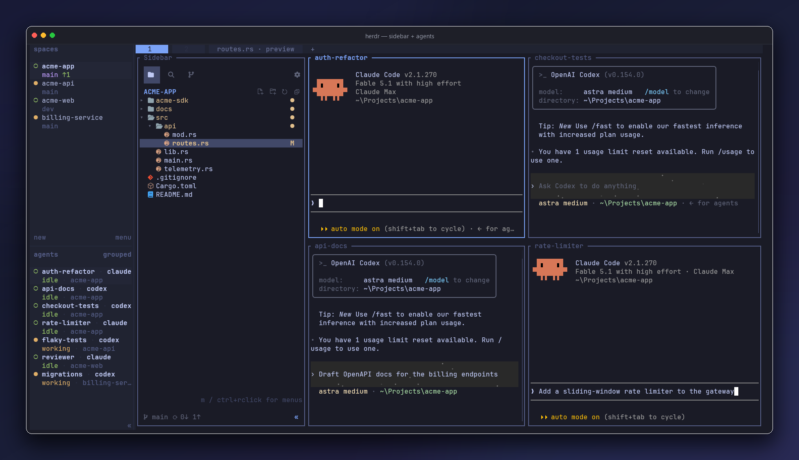

# herdr-sidebar

**The sidebar your terminal was missing** — a VS Code-inspired file explorer + source
control panel in one dockable herdr pane.



**The full tour lives in the [repo README](../../README.md)** — features, screenshots,
keys, and settings.

Quick Open is `Ctrl+P`; project text search has its own activity view and opens with `Ctrl+F`
or `Ctrl+Shift+F`. It searches live with match-case, whole-word, regex, and include/exclude filters.
Herdr keybindings can invoke `show-explorer`, `show-search`, `show-git`, or `quick-open`
directly (`-windows` suffix on Windows), so chords such as `Cmd+P` are remappable by the host.
The Git footer keeps branch switching and sync one click away in every view and can be hidden
from Settings.
Per-filetype previewers render Markdown, images, PDFs and anything else through programs you
choose; the seeded rules file suggests `glow`, `viu` and `pdfterm` or `tdf` (below). Code previews
navigate like an IDE through a language server shared by every tab via `lspmux` (below).
To open clicked files in a terminal editor, configure "Custom editor…" in sidebar Settings, then
enable "Use editor on click". Clicking an already-open file focuses its existing editor tab;
keyboard Enter continues to use the built-in preview.

### Per-filetype previewers and editors

Route file types to programs with rules. Settings → "Preview programs…" opens the global rules
file (`preview-programs.toml` in the plugin state directory, next to `state.json`) in the preview
pane; press `e` to edit it there. Two kinds of rule, each listing programs in preference order
(the first one found on `PATH` is used, so one file serves every machine):

```toml
[[preview]]                                   # rendered INSIDE the preview pane
patterns = ["*.md", "*.markdown"]
command = ["dawn -P {file}", "leaf --inline ansi:{width} {file}", "glow -s {theme} -w {width} -"]

[[preview]]
patterns = ["*.json", "*.yaml"]
command = "bat --color=always --style=plain --terminal-width {width} {file}"

[[editor]]                                    # a real terminal in its own tab
patterns = ["*.md"]
command = ["dawn {file}", "nvim {file}"]
```

A `[[preview]]` command renders the file to stdout (ANSI colours welcome) and the built-in viewer
shows the result, so Esc, pinning, placement, and replacement all work exactly as for any preview.
The file is also piped on stdin for tools that read `-`. Placeholders: `{file}` (appended when
absent), `{width}` and `{height}` (the pane body in cells), `{theme}` (`light`/`dark`), `{line}`.
Add `mode = "external"` to a `[[preview]]` rule to give the program the preview pane's real
terminal instead: it can then draw Kitty graphics or run interactively, and the pane keeps what
it drew until `q`/Esc, the next click, or a resize (which re-runs it). The plugin itself
has no built-in tools: the rules file is seeded on first use with three suggested defaults
(`glow` for Markdown, and in external mode `viu` for images and `pdfterm` or `tdf` for PDFs, which draw
real pixels on a Kitty-capable terminal); change or delete them freely. Files no rule matches
show as syntax-highlighted source. A failing rule falls back to that built-in rendering with a
one-line warning at the top. A search hit clicked at a line always shows the source view, since
rendered output has no line numbers.

An `[[editor]]` command is a real terminal editor. Pressing `e` inside a preview runs it in the
preview pane itself (the editor rule, else the global "Custom editor…") and reloads the document
when it exits; the pane is pinned meanwhile so another click opens a fresh preview rather than
interrupting the edit. The `m` / ctrl+right-click menu ("Edit with …") and a tree or search click
while "Use editor on click" is on open the editor in its own `name · editor` tab instead. With
no editor configured at all, `e` falls back to the built-in in-pane editor. Keyboard Enter always
previews.

Patterns without a `/` match the file name anywhere in the tree; patterns with a `/` match the
root-relative path (`docs/**/*.rst`). Matching is case-insensitive and the first matching rule
wins. Commands run directly, never through a shell.

A repository can ship its own rules in `.herdr-sidebar.toml` at the sidebar's root; they are
consulted before the global file, but only after you turn on "Project preview rules" in Settings
(off by default, so a cloned repository cannot run commands on a click until you opt in). The
file is hidden in the tree unless hidden files are shown.

### Code navigation

A code preview talks to a real language server, so navigation is semantic:

| Gesture | Action |
|---|---|
| Ctrl+left click on a symbol | Go to definition (one hit jumps; several open a picker) |
| Ctrl+right click, or `m` | Menu: Go to Definition, Type Definition / Implementation (when the server has them), Find References, Hover, Document Symbols, Back, Forward |
| pointer resting on a symbol | Hover documentation in a floating box (rendered by `leaf` when installed) |
| `Ctrl+-` / `Ctrl+Alt+-` | Back / forward through everything the pane showed, sidebar clicks included |
| mouse back / forward buttons | The same history steps (xterm buttons 8/9; the terminal and herdr must forward them) |

Jumps stay in the same preview pane, whatever file they land in. Results are only available on
the plain source view (not on rendered previews, diffs, or files over the viewer's size caps).

**Requirements.** Two things must exist on the machine; the plugin starts neither:

1. The [lspmux](https://codeberg.org/p2502/lspmux) service, which shares one language-server
   instance per workspace between every preview tab (and any editor using the lspmux shim).
   Install it (`brew install lspmux`, or `cargo install lspmux`) and run it as a user service:
   `brew services start lspmux` on macOS, `systemctl --user enable --now lspmux` on Linux with
   systemd after installing lspmux's `lspmux.service`, otherwise start `lspmux server` with your
   init system. Settings → "Code navigation" shows whether it is installed and running, and the
   viewer tells you the same thing on the first gesture.
2. A language server for the file type, named by an `[[lsp]]` rule in the same rules file:

```toml
[[lsp]]
patterns = ["*.rs"]
roots = ["Cargo.toml"]
command = "rust-analyzer"

[[lsp]]
patterns = ["*.ts", "*.tsx", "*.js", "*.jsx"]
roots = ["tsconfig.json", "package.json"]
command = ["tsgo --lsp --stdio", "typescript-language-server --stdio"]
```

`command` works like the other tables (a string or a preference-ordered list; the first program
on `PATH` wins) but takes no placeholders: the server receives its workspace in `initialize`.
`roots` lists the project-file names that mark a workspace root; the viewer walks up from the
file being viewed and uses the first directory holding one, else the file's git worktree root,
else the sidebar's root. The seeded file suggests rules for Rust, Go, C/C++, TypeScript/
JavaScript and Python (`rust-analyzer`, `gopls`, `clangd`, `tsgo` then
`typescript-language-server`, `ty` then `basedpyright` then `pyright`). Rules files created
before this feature do not gain them automatically: paste the ones you want.

On macOS the forward chord needs Option to act as Alt (Ghostty: `macos-option-as-alt = true`).
Windows is not supported yet.

## Install

Requires herdr 0.8 or newer. Source builds require Rust 1.89 or newer.

```
herdr plugin install alexarthurs/herdr-sidebar/plugins/herdr-sidebar
```

or from a local checkout:

```
cargo build --release
herdr plugin link .
```

Open it (or just focus a tab — the hook docks it):

```
herdr plugin action invoke herdr-sidebar.open-sidebar-windows   # windows
herdr plugin action invoke herdr-sidebar.open-sidebar           # linux / macos
```
